<p align="center">
  <h1 align="center">J.A.R.V.I.S. v2.0.0</h1>
</p>

<h3 align="center">Touchless Hand-Gesture PC Control & Dynamic Island Assistant for Windows</h3>

<p align="center">
  Real-time MediaPipe hand tracking with zero cloud dependencies at runtime,<br>
  an Apple HIG Dynamic Island with 60 FPS spring physics, OpenWakeWord streaming,<br>
  WinRT SMTC media integration, Open-Meteo weather, and Liquid Glass–style settings.
</p>

<p align="center">
  <a href="https://github.com/TalibIbrahim/JARVIS/releases"></a>
  
  
  
  
  
</p>

<p align="center">
  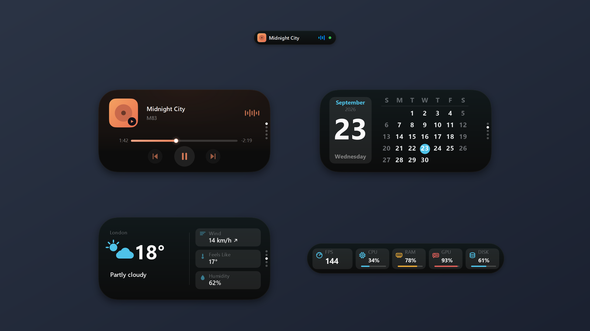
</p>

<p align="center">
  <a href="#whats-new-in-v200">What's New in v2.0</a> &middot;
  <a href="#core-architecture">Architecture</a> &middot;
  <a href="#dynamic-island">Dynamic Island</a> &middot;
  <a href="#settings-control-center">Settings</a> &middot;
  <a href="#gestures">Gestures</a> &middot;
  <a href="#voice--intelligence">Voice & Intelligence</a> &middot;
  <a href="#performance">Performance</a> &middot;
  <a href="#installation">Installation</a> &middot;
  <a href="#testing">Tests</a>
</p>

---

## What's New in v2.0.0

J.A.R.V.I.S. v2.0.0 is a massive architectural evolution that transforms JARVIS from a gesture controller into an all-in-one desktop assistant with a native **Apple Human Interface Guidelines (HIG)** Dynamic Island, an interactive **Liquid Glass Settings Window**, and a non-autoregressive **System 1 Reflex Engine**.

```
┌────────────────────────────────────────────────────────────────────────┐
│                      J.A.R.V.I.S. v2.0.0 ECOSYSTEM                     │
├────────────────────────────────┬───────────────────────────────────────┤
│ 🏝️ Dynamic Island (60 FPS)      │  Spring physics, SMTC media, weather,  │
│                                │  live timer, visual HUDs, click-thru  │
├────────────────────────────────┼───────────────────────────────────────┤
│ ⚙️ Liquid Glass Settings        │  7 Apple HIG panes, vector icons,     │
│                                │  mic meter, live config persistence   │
├────────────────────────────────┼───────────────────────────────────────┤
│ 🎙️ OpenWakeWord + VAD           │  16 kHz stream, sub-1ms intent reflex,│
│                                │  Siri typewriter, acoustic profile    │
├────────────────────────────────┼───────────────────────────────────────┤
│ 🎵 WinRT Media & Weather       │  Native Windows SMTC adapter,         │
│                                │  Open-Meteo REST API, WMO conditions  │
├────────────────────────────────┼───────────────────────────────────────┤
│ 🧠 Context Memory & Resolvers  │  In-memory 5 turns, pronoun resolution│
│                                │  ("open it", "louder", "do that again")│
├────────────────────────────────┼───────────────────────────────────────┤
│ ⏱️ Scheduler & Local AST Math   │  Reboot-safe timers, safe math parser,│
│                                │  unit conversions, quick notes & docs │
├────────────────────────────────┼───────────────────────────────────────┤
│ 👁️ Vision Screen Awareness      │  One-shot explicit Groq Vision audit, │
│                                │  translucent visual sending capsule   │
├────────────────────────────────┼───────────────────────────────────────┤
│ 🛡️ Strict Privacy Audit Log    │  50-event thread-safe ring buffer     │
│                                │  logging all external cloud dispatches│
└────────────────────────────────┴───────────────────────────────────────┘
```

---

## Dynamic Island

Built entirely with native PySide6 and running at **60 FPS**, the Dynamic Island floats seamlessly at the top center of your primary screen. It combines `WS_EX_TRANSPARENT` for total click-through transparency during idle states with bounded interactive windows (`WS_EX_NOACTIVATE`) when expanded—ensuring focus is never stolen from your games, IDEs, or full-screen apps.

<table>
  <tr>
    <td align="center">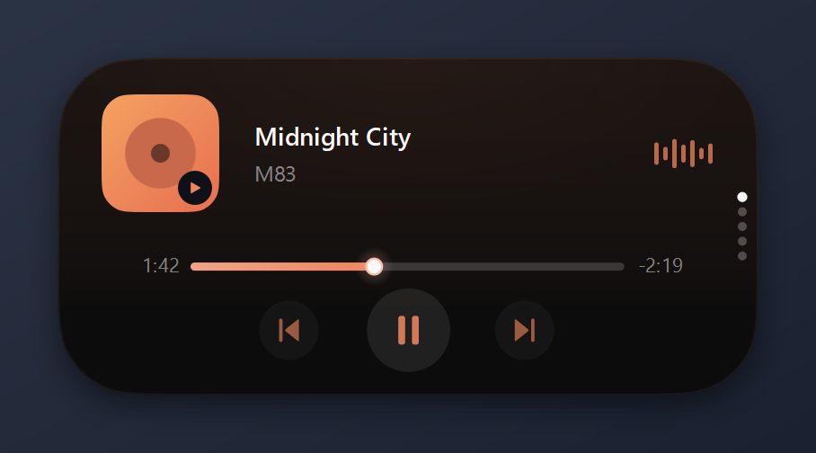<br><sub>Now Playing (album-art tint)</sub></td>
    <td align="center">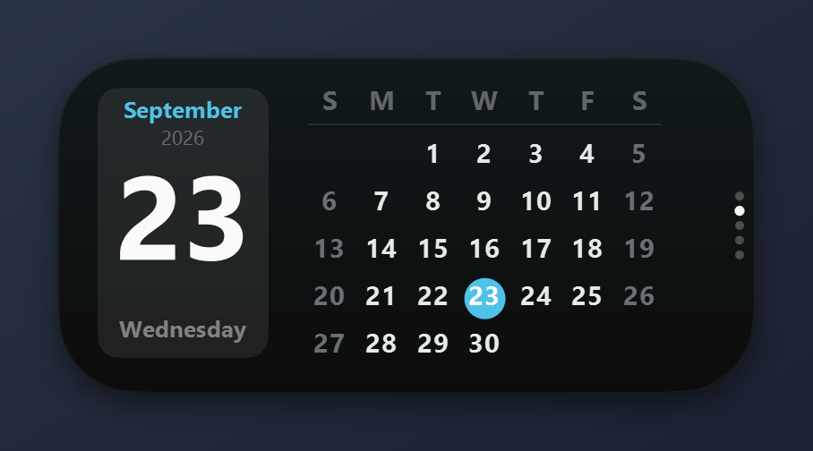<br><sub>Calendar</sub></td>
  </tr>
  <tr>
    <td align="center">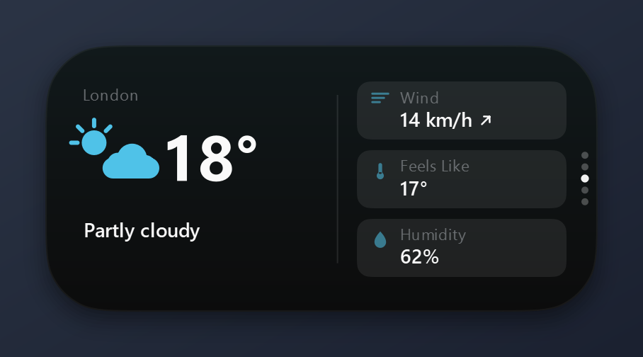<br><sub>Weather</sub></td>
    <td align="center">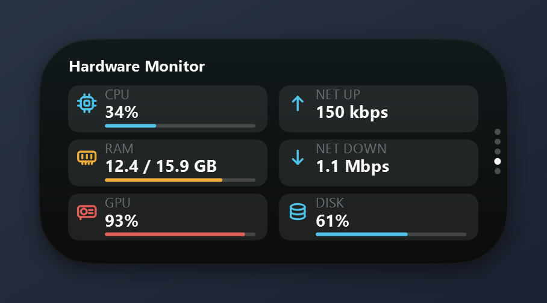<br><sub>Hardware Monitor</sub></td>
  </tr>
  <tr>
    <td align="center">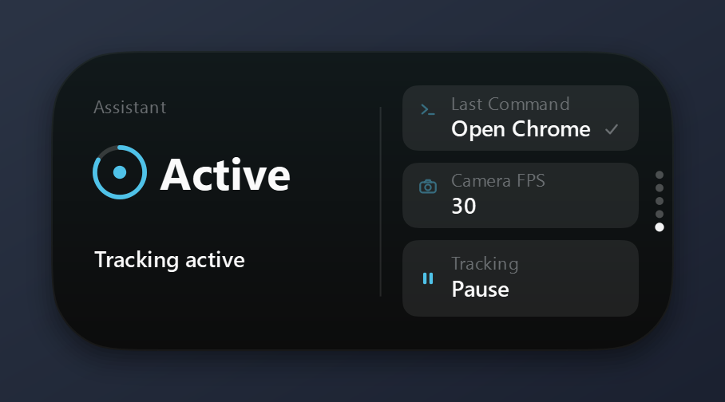<br><sub>JARVIS status &amp; tracking control</sub></td>
    <td align="center">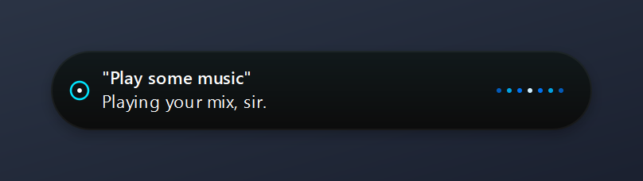<br><br>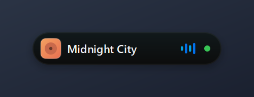<br><sub>Assistant reply &middot; compact pill</sub></td>
  </tr>
</table>

<p align="center">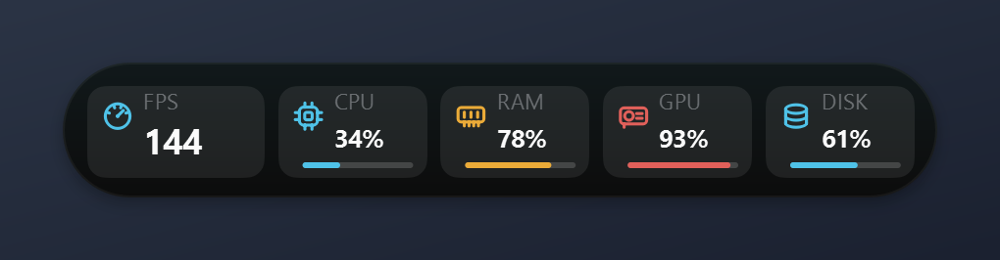<br><sub>Hardware strip with live tracking FPS</sub></p>

### Island State & Widget Architecture

| State / Widget | Behavior & Visual Presentation |
|---|---|
| **Standby / Idle Pill** | Compact 140x32 pill with subtle breathing glow, concentric Apple corners, or configurable live Time + Weather. |
| **Wake Word Detection** | High-speed spinning arc-reactor with golden circular progress ring responding to speech or 0.8s palm hold. |
| **Active Listening** | 5-bar dancing audio-reactive waveform displaying voice activity. |
| **Thinking Shimmer** | Sweeping gradient shimmer across the capsule while executing System 1 intents or Groq queries. |
| **Live Typewriter Streaming** | Siri-style character-by-character typewriter streaming with smooth cyan cursor (`▍`). |
| **Now Playing Media Card** | WinRT SMTC session metadata (track, artist), dominant color accent glow, live progress bar, and interactive playback buttons (Previous, Play/Pause, Next). |
| **Weather & Forecast Card** | Current temperature, feels-like, wind speed, WMO weather glyph, and 6-hour forecast row powered by Open-Meteo. |
| **Live Activity Countdown** | Circular leading progress ring with tabular numerals and countdown time card. |
| **Disambiguation Card** | Numbered interactive chips (1, 2, 3) for resolving ambiguous queries via voice (*"one"*, *"two"*) or cursor dwell. |
| **Screen Awareness HUD** | Pulsating camera aperture with cyan privacy shimmer indicating explicit one-shot screen analysis. |
| **Gesture HUD Capsules** | Minimalist volume slider HUD and active window title switcher HUD. |
| **Fullscreen Suppression** | Automatically suppresses overlay when Win32 `SHQueryUserNotificationState` detects full-screen games or presentations. |

---

## Settings Control Center (Liquid Glass)

<p align="center">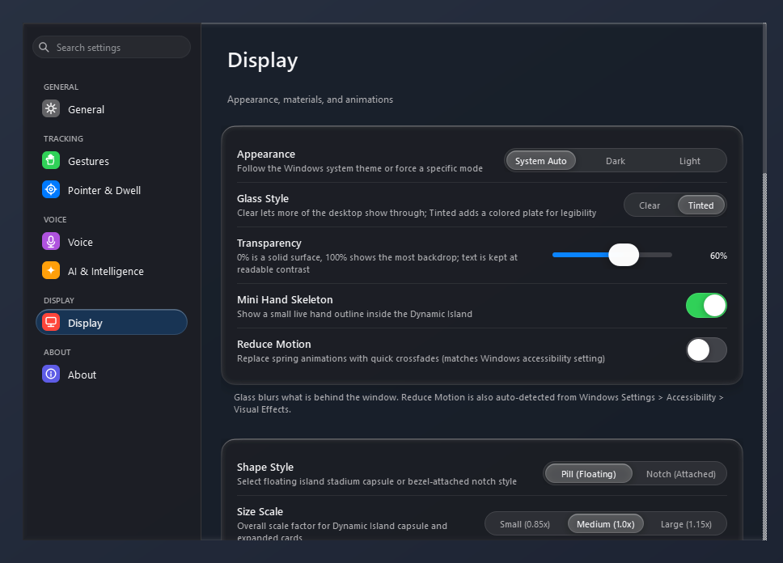</p>

J.A.R.V.I.S. v2.0.0 features a completely redesigned, Apple HIG-compliant Settings Window (`ui/settings_window.py`):

- **Apple Sidebar Navigation**: 240px sidebar with antialiased Apple vector squircle tiles (`⚙`, `✋`, `🎯`, `🎙`, `✦`, `🖥`, `ℹ`), real-time search filtering, and categorized sections.
- **7 Dedicated Configuration Panes**:
  1. **General**: Windows startup toggle, Single-Instance mutex lock, and hardware diagnostics telemetry.
  2. **Hand Tracking**: Selection between *Palm & Fist*, *Kinect Dwell*, and *Legacy Pinch* schemes; reach margins, and deadzone hysteresis.
  3. **Precision Aim**: Metacarpal knuckle anchor point, Lookback aim stabilization buffer, and Click Freeze threshold calibration.
  4. **Voice & Wake Word**: OpenWakeWord streaming engine, wake word sensitivity slider, Iron Man acoustic chimes, and follow-up conversational window.
  5. **Dynamic Island**: Idle layout modes (*Off*, *Time*, *Time + Weather*), SMTC media toggle, Open-Meteo weather city & unit options, expansion triggers (*Hover*, *Dwell*, *Click*), and island scaling (*Compact*, *Default*, *Large*).
  6. **Display & Audio**: Per-Monitor DPI scaling, physical camera selection, audio output endpoint, and live interactive microphone VU level meter.
  7. **About & Updates**: Current version (`v2.0.0`), Discord-style atomic auto-updater, and GitHub release channel manager.
- **Native Components**: `GroupedCard` containers, antialiased `AppleComboBox` dropdowns, fluid spring-animated `AppleToggle` switches, and `SliderCardRow` sliders.

---

## Gestures & Control Schemes

Choose between two high-precision control schemes in Settings (`Control Scheme`).

### 1. Palm & Fist Scheme (Default)
Anchored on the rigid **metacarpal knuckles (landmarks 0, 5, 9, 13, 17)** rather than moving fingertips, eliminating jitter and closing displacement.

| Gesture | Action | Thresholds & Mechanics |
|---|---|---|
| **Open Palm** | **Move Cursor** | Rigid metacarpal knuckle anchor; trackpad-style relative acceleration + precision aim. |
| **Quick Fist (< 400 ms)** | **Left Click** | Closing fingers into a fist and reopening within 400 ms triggers left click. 200 ms Lookback Buffer locks aim. |
| **Two Quick Fists (< 0.65 s)** | **Double Click** | Two quick fists within 0.65 s fires native Windows double click. |
| **Fist Held (> 350 ms)** | **Drag & Drop** | Latches left mouse button down; cursor follows hand; opening the hand drops the item (`DROP`). |
| **Thumb + Middle Pinch** | **Right Click** | Thumb contacts middle fingertip (`pinch_tm < 0.28`). |
| **Peace Sign (move up / down)** | **Scroll** | Index and middle fingers extended; vertical travel scrolls documents and webpages smoothly. |
| **Two Open Hands (spread / close)** | **Zoom In / Out** | Moving both hands apart zooms in; bringing together zooms out (`Ctrl` + scroll). |
| **Vertical Hand Slide** | **Volume HUD** | Sliding hand up/down adjusts master volume in 5% increments with Dynamic Island HUD feedback. |
| **Horizontal Hand Swipe** | **Switch App** | Horizontal swipe triggers Alt+Tab with Dynamic Island window title preview. |
| **Open Palm in Standby (0.8 s)** | **Wake Up** | Circular golden wake ring completes; app transitions from Standby to Active. |
| **Thumbs-Up (hold 1.2 s)** | **Standby** | 4 fingers curled, thumb extended upward for 1.2 s returns Jarvis to standby. |

### 2. Dwell-Click (Kinect-Style Hover to Click)
- **Hover Trigger**: Hovering still within a 14 px radius for 1.0 s triggers a left click.
- **Translucent Progress Ring**: An Apple visionOS-style translucent glass ring fills around the cursor and pulses on completion.
- **Radial Action Menu**: Optional mode where hovering reveals an action menu: *Click, Double Click, Right Click, Drag, Scroll*.

<p align="center">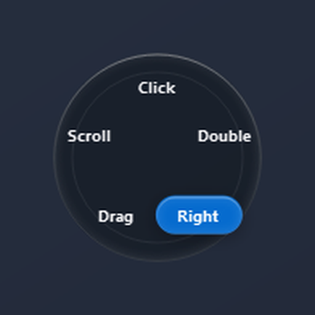</p>

---

## Voice & Intelligence

Speak naturally after the wake word *"Jarvis"*:

```
"Jarvis, what's the weather"       "what's playing"         "next track"
"play / pause"                    "open my downloads"      "open programming folder"
"what's 45 times 128"             "convert 50 miles to km" "set timer for 10 minutes"
"what time is it in Tokyo"        "note that review PR"    "inspect my screen"
"volume up"                       "snap window right"      "switch to Chrome"
"copy this"                       "open this"              "close window"
"start work mode"                 "stealth mode"           "run diagnostics"
```

### Intelligent System Components

- **OpenWakeWord 16 kHz Streaming**: Low-latency, high-accuracy acoustic wake-word neural network running locally on-device.
- **Laya-Style System 1 Reflex Engine**: Sub-millisecond (< 1.0 ms) non-autoregressive intent vectorizer (`decision_engine.py`) classifying commands with zero cloud latency.
- **Conversational Context Memory**: 5-turn in-memory resolver resolving natural pronouns (*"open it"*, *"make that louder"*, *"do that again"*, *"no, the other one"*).
- **Local AST Math & Unit Engine**: Deterministic Python AST arithmetic parser (`+`, `-`, `*`, `/`, `^`, `%`, `sqrt`) and multi-dimensional unit converter without cloud LLM dependencies.
- **Security-Gated Folder Indexer**: Depth-bounded fuzzy indexer with strict extension allowlists preventing arbitrary executable execution.
- **One-Shot Groq Vision**: Screen awareness for visual troubleshooting (*"explain this error"*, *"what is on my screen"*), with visual camera aperture indicator on the Dynamic Island.
- **Privacy Audit Log**: Thread-safe ring buffer recording timestamps and payload digests for every cloud request.

---

## Performance

Tested on Windows 11 with an Intel Core i7 laptop and integrated 720p/1080p webcam:

| State | CPU Usage | Memory | Latency / FPS |
|---|---|---|---|
| **Standby (Collapsed Pill)** | **< 0.15%** (Background throttled to 10 FPS) | ~110 MB | Wake trigger within 0.8s |
| **Active Tracking (HUD Off)** | **14% – 19%** (Single hand, 30 FPS camera) | ~135 MB | Gesture latency < 1 ms |
| **Active Tracking + Telemetry HUD** | **18% – 24%** (Full skeleton preview) | ~150 MB | 30 FPS camera / 60 FPS overlay |
| **Cursor Smoothing Jitter** | **< 0.5 px** at rest (One Euro filter) | — | Sub-pixel stability |
| **System 1 Intent Reflex** | **< 1.0 ms** (Deterministic vectorizer) | — | Instantaneous response |

---

## Installation

### Prerequisites
- **Operating System**: Windows 10 or Windows 11 (64-bit).
- **Python**: Python 3.12 (recommended) or 3.10–3.11.
- **Hardware**: Standard USB or built-in webcam, microphone, and audio speakers.

```powershell
# 1. Clone the repository
git clone https://github.com/TalibIbrahim/JARVIS.git
cd JARVIS

# 2. Create and activate a Python 3.12 virtual environment
python -m venv .venv
.\.venv\Scripts\activate

# 3. Install dependencies
pip install -r requirements.txt

# 4. Launch J.A.R.V.I.S.
python main.py
```

### Command Line Arguments
- `python main.py`: Starts Jarvis in normal background mode with the Dynamic Island overlay.
- `python main.py --preview`: Opens the camera HUD window showing hand skeletons and live telemetry.
- `python main.py --island-demo`: Cycles through all 23 Dynamic Island states, widgets, and gesture HUDs.
- `python main.py --test-mic`: Runs interactive microphone and speech recognition diagnostics.
- `python main.py --diagnose`: Runs jitter, latency, anchor point, and pre-click drift benchmarks.
- `python main.py --no-voice`: Disables speech recognition for presentation environments.
- `python main.py --camera 1`: Selects an alternate camera index.

---

## Testing

Run the comprehensive unit test suite:

```powershell
.\.venv\Scripts\python.exe -m pytest
```

```
====================== 458 passed, 2 warnings in 22.90s =======================
```

All **458 unit tests** pass across 16 test suites covering:
- MediaPipe gesture state machines & Lookback buffer stabilization.
- Dynamic Island state machine, 60 FPS spring physics, and content arbitration.
- Open-Meteo weather client caching & WMO translation.
- Windows SMTC media playback adapter & debounced commands.
- Local scheduler persistence, timers, alarms, and reminders.
- Context memory pronoun resolution & disambiguation chips.
- AST math evaluation & physical unit conversions.
- System control, pycaw audio, WMI display brightness, and power gates.
- Screen awareness one-shot privacy safeguards & external privacy logging.

---

## Packaging to Standalone Executable

To build a standalone Windows executable (`dist/jarvis/jarvis.exe`):

```powershell
python build_exe.py
```

---

## License

This project is licensed under the MIT License — see the [LICENSE](LICENSE) file for details.
